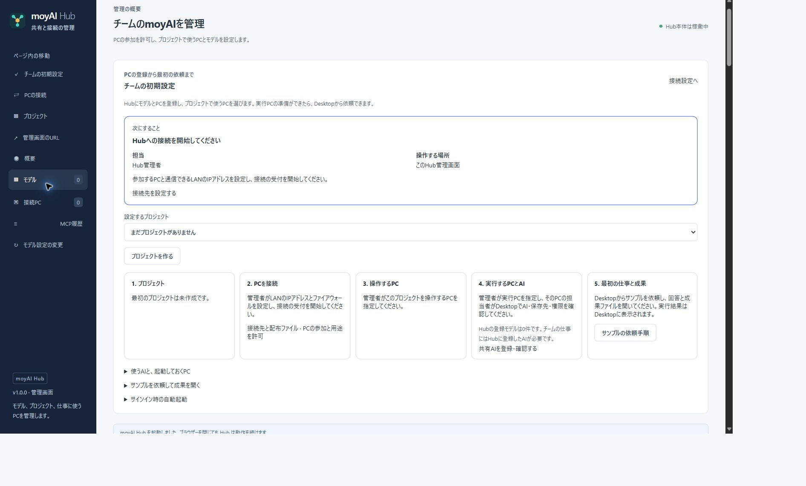

# moyAI Hub

[Hubのリリース](https://github.com/midi-ai-labs/moyAI-Hub/releases) · [moyAI Desktop](https://github.com/midi-ai-labs/moyAI) · [チームの準備](docs/team-preparation.md)

moyAI DesktopのAI接続、PCの参加、共有プロジェクトを管理するRustサーバーです。管理画面は通常のWebブラウザーで開きます。Hub 1.0.1のWindows x64単体版は、Program FilesへのSetupと、Hub専用の保存データ初期化を同梱します。Hub自体にTauriやWebView2は不要です。[1.0.1の変更点](docs/release/v1.0.1.md)・[Windowsへの導入と削除](docs/windows-setup.md)を参照してください。

管理サーバーにはHubを、依頼を送る操作PCや仕事を実行するPCには[moyAI Desktop](https://github.com/midi-ai-labs/moyAI)を用意します。Desktopの導入は[Windowsへの導入と更新](https://github.com/midi-ai-labs/moyAI/blob/main/docs/user/windows-setup.md)を参照してください。DesktopとHubの配布物は、それぞれの[Desktopリリース](https://github.com/midi-ai-labs/moyAI/releases)・[Hubリリース](https://github.com/midi-ai-labs/moyAI-Hub/releases)から取得できます。



## チームで使い始める

1. ZIP全体を展開し、`Setup-Hub.cmd`を通常の権限で実行します。配置時だけ管理者承認し、通常の権限で管理画面を開きます。次回からはスタートメニューの **moyAI Team Management** で開きます。起動したWindowsユーザーに管理を許可します。IDやパスワードの入力は不要です。
2. Hub PCの管理画面でAIの接続先とモデルを登録し、「最初に使う共有モデル」を選びます。AIサーバーの起動・モデルロードはホスト側で行います。
3. **PCの接続** でLAN側のIP・ポートを設定して接続受付を開始し、Windowsの受信許可を確認します。必要時は確認した範囲をUACで設定するか、管理者向けスクリプトを保存します。
4. **接続ファイルの配布** から `hub-config.moyai-join` を保存して各PCへ渡し、届いた参加申請を許可します。同じファイルを複数PCへ配れます。
5. プロジェクトを作り、操作PC・実行PCを指定します。同じPCを両方に使えます。各実行PCでは実行許可と、そのプロジェクトの作業フォルダーを登録します。
6. 操作PCのDesktopに現れる `Hub` 印付きプロジェクトで依頼し、回答と成果を確認します。

PCごとにIDと鍵を持ち、同じWindowsユーザー名でも別PCを自動統合しません。通常の利用者アカウント作成・ログインは不要です。共有会話は通常の入力欄を使い、AIが許可されたPCを選択できます。Hubは端末フォルダーの実パスを決めず、各端末が登録した場所を使います。

操作別の詳細は[チームの準備](docs/team-preparation.md)、[受信許可](docs/firewall.md)、[Desktopの共有プロジェクト](https://github.com/midi-ai-labs/moyAI/blob/main/docs/shared-work-desktop.md)を参照してください。

## 起動・管理・終了

| 操作 | 操作方法 |
| --- | --- |
| 起動または管理画面を開き直す | `Start-Hub.cmd` / `moyai-hub.exe --launch` |
| 状態を見る | `moyai-hub.exe --status` |
| HubとGatewayを終了する | `Stop-Hub.cmd` / `moyai-hub.exe --stop` |

初回のローカル管理URLは `http://127.0.0.1:9080/admin/` です。初回は実行ファイルと同じフォルダーの `web-management.json` を使います。別の固定ポートは `Setup-Hub.cmd -WebPort 9081` のように指定できます。Program Files内のテンプレートを編集する必要はありません。指定ポートが使用中なら起動エラーになり、別のポートへ自動では切り替わりません。更新時にポートを指定しなければ保存済み設定を使います。

起動に成功した設定は保存先の `web-management.json` に保存され、次回からはこちらを使います。同梱ファイルの変更は、保存済みの設定へ反映されません。設定を変更する場合はHubを停止し、`--web-port PORT` または `--web-settings FILE` を指定して起動します。形式と手順は[Web管理](docs/web-management.md)を参照してください。

`Start-Hub.cmd` が管理画面を開き、現在のURLは `--status` でも確認できます。URLだけを開いても管理権限は得られないため、上の方法で開きます。ブラウザーを閉じてもHubと仕事は続きます。「接続の受付を停止」は端末通信を止めますが、Web管理画面は残ります。

`--launch` は成功した接続設定を再開し、起動済みなら同じHubを使います。ネットワークの再開に失敗した場合はWeb画面から修正できます。直接 `moyai-hub.exe` を実行するコンソール起動では、端末通信を画面から開始します。

実行ファイルは `%ProgramFiles%\moyAI\Hub`、利用者ごとの保存先は `--data-dir`、`MOYAI_HUB_DATA_DIR`、Windows既定の `%LOCALAPPDATA%\midi-ai-labs\moyai-data\hub` の順で決まります。旧既定の `%APPDATA%\ai.midi.moyai.hub` は、停止を確認して初回起動時に移動します。新旧両方にデータがある場合は自動統合しません。指定した保存先は状態確認・終了にも同じものを使います。ログオン時の自動起動はローカル管理画面から設定できます。OSサービスやサインアウト後の稼働ではありません。

別PCからの管理には、管理を許可されたDesktopとHTTPS管理URLが必要です。[Web管理](docs/web-management.md)を参照してください。Desktopへ渡す端末接続URLと管理画面のURLは別です。

## AIを登録・確認する

1. ホストの種類と生成API（Chat Completions / Responses）を選び、HTTP(S) URLまたはIPとポートを入力します。認証が必要なホストでは **APIキー（必要な場合）** にキーを入力し、「モデルを取得」を押します。
2. 取得したモデルを選び、表示名を付けて登録します。ツール利用を実際に確認したモデルだけ「ツール利用を許可」を選びます。
3. 必要に応じて同じモデルの別ホストや、同時接続数を共有するグループを追加します。
4. 「状態を確認」でモデル一覧の掲載状況を確認し、Desktopから実際の依頼を試します。

| 表示 | 意味 |
| --- | --- |
| 一覧あり | ホストの最新一覧で登録モデルを確認した |
| モデルなし | 一覧を取得できたが登録モデルがなかった |
| 未確認 | この起動後、モデル一覧をまだ確認していない |
| 再確認待ち | 確認結果の有効期間が過ぎたか、直近の確認に失敗した。実行前に再確認する |
| 接続・確認不可 | 直近のモデル確認に失敗した |
| メンテナンス | 管理者が新規割当から外している |

「一覧あり」は生成やツール利用の成功を保証しません。「再確認待ち」はモデルの登録が消えたことを示すものではありません。現在の状態を確認するには「状態を確認」を押します。名前解決できない接続先は、到達可能なホスト名・IPを確認してください。

Hubはモデルの登録先ごとにAPIキーを保存し、モデル一覧の確認と生成に使います。各Desktopへの入力は不要です。登録先の「編集」で、空欄のまま保存すると現在のキーを保持し、新しいキーを入力すると変更します。削除する場合は **保存時にAPIキーを削除する** を選びます。

Hubの **最初に使う共有モデル** ではMain、Sub（サイドチャット）、Approve（承認判定）の標準モデルをまとめて保存します。同じ登録モデルを複数の用途で使えます。Mainにはツール利用対応モデルを選び、SubとApproveには通常のチャットモデルも選べます。SubとApproveの未指定値をMainで補完しません。

モデルには任意の指示を16,384 Unicode文字まで保存できます。Hubのcatalog保存ファイル全体は4 MiBまでで、登録数・指示・変更履歴を含めたJSONのバイト数で検査します。超過する変更は拒否し、現在の設定を保持します。指示を短くするか、不要なモデル登録を削除してください。

Hub設定済みのDesktopは共通の **AIの接続** で用途ごとに標準または登録済みモデルを選びます。Main、Sub、Approveは別選択で、Runnerは実行PCのMainを使います。Approveの選択は既存のGuardian判定に使うモデルを指定します。Hub停止中は手入力先へ自動では切り替わりません。Desktopの接続リセットはHub応答なしで使えます。

モデル通信は別プロセスのGatewayが中継し、そのHTTP同時接続数を制限します。モデルのロード・GPU容量・生成の終了はAIホストが管理します。[Gateway](docs/gateway.md)、[要求の待ち順序](docs/request-queue.md)、[子エージェントのモデル経路](docs/delegated-execution.md)に境界を記載しています。

## プロジェクト・保存・互換性

Hubは共有会話、仕事、入力、公開成果、実行枠と停止確認を保存します。Desktopからプロジェクトを離脱しても他PCや実ファイルは削除しません。Hubで参加解除・プロジェクト削除を行うとDesktopの通常一覧から外れます。再参加は新しい参加として扱います。会話の削除や停止は、実行中の仕事・保持アプリの停止確認と区別します。

保存先にはcatalog、端末台帳とCA、共有仕事DBとファイルを保持します。破損した設定を空データで置き換えません。配布する接続ファイルは公開URLとCAだけで、Hubの保存ディレクトリーをそのまま配布しません。停止したHubのバックアップ・復元は[共有仕事の運用](docs/shared-work.md#保守と復元)を参照してください。

APIキーはHub PCの利用者に限定したファイル権限で保護します。暗号化保存ではありません。Hubのバックアップには含めないため、復元・別PCへの移行後は管理画面で設定し直してください。保存済みのキーが使えない場合、認証なしでは接続しません。[保存と中継の境界](docs/gateway.md#aiホストのapiキー)を参照してください。

旧端末間MCPの保存記録は[MCP履歴](docs/mcp-history.md)から参照できます。旧グループ・方向付き許可・同一PC用のtoken接続APIは互換用途として残りますが、新規チーム導入は上記の端末登録とプロジェクトを使います。[PC登録の管理](docs/device-registry.md)、[共有API](docs/shared-work.md)、[実装索引](docs/architecture.md)を参照してください。

## 開発・検証

```powershell
npm ci
npm test
npm run build
cargo test --all-features -- --test-threads=1
cargo build --bin moyai-hub
```

Web画面はRustビルドへ同梱するため、UI変更後は `npm run build` に続けてRustをビルドします。通常の実ブラウザー確認は `npm run verify:gui`、広い回帰は `npm run verify:gui -- --suite regression` です。[ブラウザー試験](tests/browser/README.md)で自動操作と目視・物理受入を区別します。

### Windows単体版を作る

`scripts/package-release.py` はPython 3.11以降の標準ライブラリーだけで配布ZIPを作ります。変更をマージした後、変更の残っていないcommitでWeb画面とrelease実行ファイルをビルドしてください。ビルドログと出力先はrepositoryの外に置きます。

```powershell
$releaseWork = [IO.Path]::GetFullPath('..\project_sandbox\hub-release')
New-Item -ItemType Directory -Force -Path $releaseWork | Out-Null
$hubCommit = (git rev-parse HEAD).Trim()
npm run build
cargo build --offline --locked --release --bin moyai-hub --message-format=json |
  Out-File -LiteralPath "$releaseWork\hub-build.jsonl" -Encoding utf8
python .\scripts\package-release.py `
  --build-log "$releaseWork\hub-build.jsonl" `
  --notices C:\release-inputs\THIRD_PARTY_NOTICES.txt `
  --expected-commit $hubCommit `
  --desktop-source-commit $desktopCommit `
  --output "$releaseWork\distribution"
```

`$desktopCommit` にはDesktop文書の参照に使う40文字のcommitを指定します。互換性確認の記録ではありません。第三者通知は今回のビルドが使う依存・version・featuresと一致する内容を事前に確認して用意します。スクリプトはバージョン5箇所の一致、cleanなcommit、Cargoログ内のrelease実行ファイルを確認し、初期JSON、起動・終了用ファイル、文書、LICENSE、第三者通知を同梱します。identity、manifest、SHA256一覧も生成します。既存の出力は上書きしません。公開前に、生成したZIPを展開して `Start-Hub.cmd` の実画面での起動と停止を確認してください。

2026-09-23の隔離Live試験では、同一Windows上の仮想WinAから唯一の実行PC WinBへの依頼・実行・成果取得を確認しました。複数の実行PCからのAI選択、物理別Windows、実Firewall、長時間運転、最終配布物は別の確認が必要です。実装済みAPIや自動試験の成功を正式リリースの合格とは扱いません。
